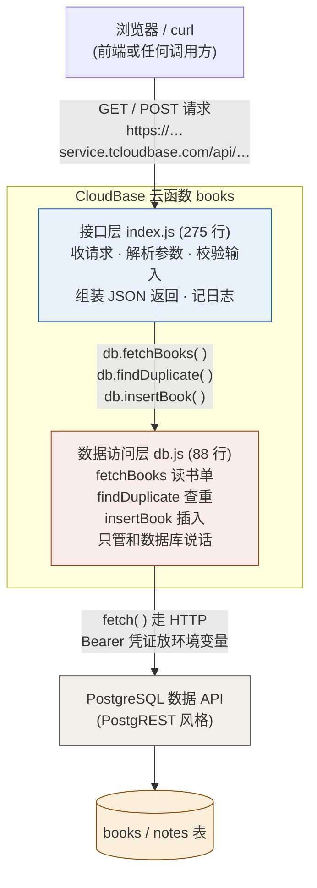

<!-- docs/layering.md · Day 19 余力加练：后端分层示意图 -->
# 后端分层示意图（Day 19）

> 今天的主题：把「查数据库」的代码从 `index.js` 拆到 `db.js`。这张图记录拆分后的结构，以后每加一层（比如 notes 接口）都照这个套路。

## 全景图

## 拆分前后对比

| | 拆分前（Day 17–18） | 拆分后（Day 19） |
|---|---|---|
| 文件 | 只有 `index.js`（323 行，一锅烩） | `index.js` + `db.js` 各司其职 |
| 查库代码位置 | index.js 第 157~210 行 | 全部在 `db.js`，`module.exports` 导出 |
| index.js 怎么用 | 直接调函数 | `const db = require("./db")` 后调 `db.xxx( )` |
| 改数据库逻辑 | 在 320 行里大海捞针 | 只打开 88 行的小文件 |

## 各层职责边界（分层后必须守住）

| 层 | 负责 | 不负责 |
|---|---|---|
| 接口层 `index.js` | 收请求、解析 `?limit`、校验输入（门卫）、把错误翻译成人话、组装 `{ok, data/error}` 返回、记日志 | 不直接 `fetch` 数据库 |
| 数据访问层 `db.js` | 拼 PostgREST 请求、带凭证、8 秒超时、把行数组/201 状态交上去；出错就 `throw` | 不做输入校验、不翻译错误（那是「和人说话」，归接口层） |

## 为什么值得拆（不只是为了好看）

1. **改动隔离**：哪天换存储方式，只改 `db.js`，接口层一行不动；
2. **可以复用**：以后 notes 接口上线，`db.js` 加函数即可，套路照抄；
3. **可以单独测**：把 `PG_API_BASE` 指向假数据源（见 `day19-verify/mock-pg.js` 的做法），不动真库就能把整条链路测一遍。

## 部署小抄（Day 19 实测的坑）

- **多文件函数不能用控制台「上传代码」的 zip 方式**——会报 `filename not matched: scf_bootstrap`（zip 整包替换会把平台自动生成的启动脚本弄丢）；
- 正确姿势：控制台「在线开发」IDE 里新建/粘贴文件 → 保存 → 用 IDE 里的「部署」按钮；
- 提示「无 package.json 无法安装依赖」时选**「部署且不安装依赖」**——本项目零 npm 依赖；
- 线上验证域名用 `https://reading-sea-d7gd8l7o78b7304ae.service.tcloudbase.com`。
